

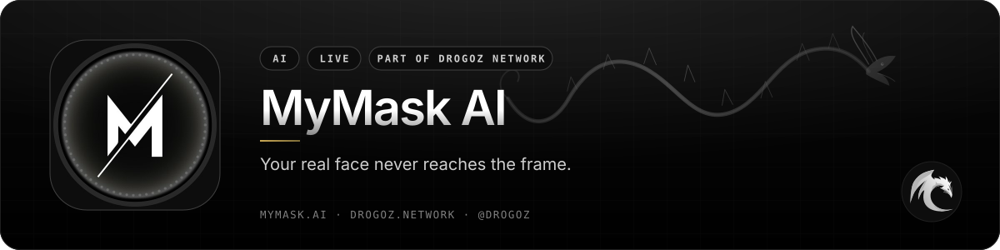

 

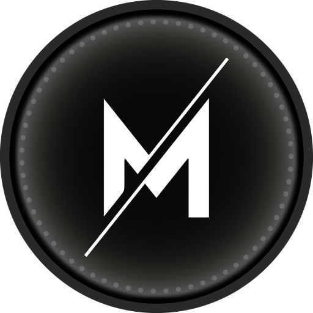

# MyMask AI

### Your real face never reaches the frame.

 

  

 

## 📋 Table of contents

- [Overview](#-overview)
- [Key features](#-key-features)
- [Screenshots](#-screenshots)
- [How it works](#%EF%B8%8F-how-it-works)
- [Use cases](#-use-cases)
- [Pricing](#-pricing)
- [Free live demonstration](#-free-live-demonstration)
- [Links](#-links)

## 🧭 Overview

**MyMask AI is a professional, local identity-protection engine for live video.** It intercepts the camera feed on the device, maps and aligns the face, transforms it through a custom neural model, harmonises lighting and motion, sanitises the output and exposes the result as a virtual camera for conferencing, recording and streaming applications.

The current **MyMask AI Desktop 3.1** is built for Windows 10/11 and NVIDIA CUDA. The site describes a multi-stream GPU pipeline targeting sub-frame latency and 60+ FPS, plus an anti-freezer scheduler intended to keep long sessions stable under load. The output can be selected as a camera in Zoom, Google Meet, Microsoft Teams, Skype, OBS, Streamlabs, browsers and recording tools.

**Processing stays on the user's machine:** the public product specification states that raw frames are not uploaded, telemetry is not collected and no third-party processing server sits in the video pipeline. The product also describes a one-way transformation matrix and an output-sanitisation layer. These are product security claims; users should assess suitability for their own threat model and use the software only with the knowledge and consent required by law.

Licensing is now self-service. The live calculator starts at **$3,499 per month for one computer**, applies duration and volume discounts in real time, and supports renewals for 1, 3, 6 or 12 months. Crypto top-ups are auto-credited after confirmation through a signed checkout.

<table>
<tr>
<td align="center" width="25%"><b>Category</b> AI</td>
<td align="center" width="25%"><b>Status</b> Live</td>
<td align="center" width="25%"><b>Bundle</b> Utilities (−2%)</td>
<td align="center" width="25%"><b>Pricing</b> $3,499 / month</td>
</tr>
</table>

## ✨ Key features

### 🧠 Local real-time engine

- **Six-stage pipeline** — Capture → Detect & Align → Transform → Blend → Sanitize → Output.
- **NVIDIA CUDA, multi-stream processing** — GPU-parallel execution tuned for real-time video rather than static photos.
- **Sub-frame target and 60+ FPS positioning** — designed to preserve natural expression and motion with no noticeable delay.
- **Virtual-camera output** — use MyMask AI in conferencing, streaming, browser WebRTC and recording workflows.

### 🧬 Identity models & output

- **Custom-developed neural models** — photorealistic output with lighting, skin tone and motion blending.
- **Built-in identity library** — select a prepared model and go live.
- **Custom AI models (Elite)** — generate a personalised identity from your own permitted source images.
- **Output sanitisation** — the product's anti-detection layer is designed to reduce synthetic artefacts in the virtual-camera stream.

### 🔒 Privacy & session stability

- **100% local processing architecture** — no cloud frame uploads, third-party video processor or telemetry in the documented pipeline.
- **One-way transformation design** — the site states that the source identity is not embedded or cached in the transformed output.
- **Anti-freezer scheduler** — dedicated CUDA streams and a controlled frame budget for sustained calls and multitasking.
- **Code-signed desktop release and automatic updates** — version 3.1 is delivered through the authenticated account.

### 💳 Licensing, payment & support

- **Interactive licence calculator** — configure computers and duration; volume and term discounts are applied live.
- **Standard licence** — $3,499/month for one computer before calculator discounts.
- **Automatic crypto balance credit** — USDT (TRC20/BEP20/ERC20), USDC (ERC20/Solana), BTC, ETH, BNB, SOL and TRX.
- **Renew at any time** — add 1, 3, 6 or 12 months without losing remaining time.
- **Dedicated support and demo** — setup and tuning assistance through MyMask/Drogoz support.

### 🖥️ Desktop requirements & compatibility

- **Windows 10/11 (64-bit)** · **NVIDIA GPU with CUDA 11.0+** · **DirectX 12**.
- **8 GB RAM minimum, 16 GB recommended** · approximately **500 GB free storage** · internet connection.
- **Video:** Zoom · Google Meet · Microsoft Teams · Skype · standard webcam applications.
- **Streaming:** OBS Studio · Streamlabs · YouTube Live · Twitch · custom RTMP pipelines.
- **Browser & recording:** Chrome · Edge · Firefox WebRTC · local camera/screen recording.

## 📊 Current product status

| Area | Current state |
|---|---|
| **Desktop engine** | Version 3.1 · Windows 10/11 · code-signed · automatic updates |
| **Core pipeline** | CUDA engine, one-way transformation design, output sanitisation and anti-freezer scheduling — shipped |
| **Custom identities** | Elite model training — shipped |
| **RTX 5000 series** | Native kernels and tuning — in progress |
| **Cross-platform / mobile bridge** | Planned |
| **Published performance positioning** | <1-frame target · 60+ FPS · multiple CUDA streams · 99.9% session uptime |

## 🖼️ Screenshots

> Product images from [mymask.ai](https://mymask.ai/) and the [service page](https://drogoz.network/services/MyMask/) on drogoz.network.

<table>
<tr>
<td width="50%" align="center">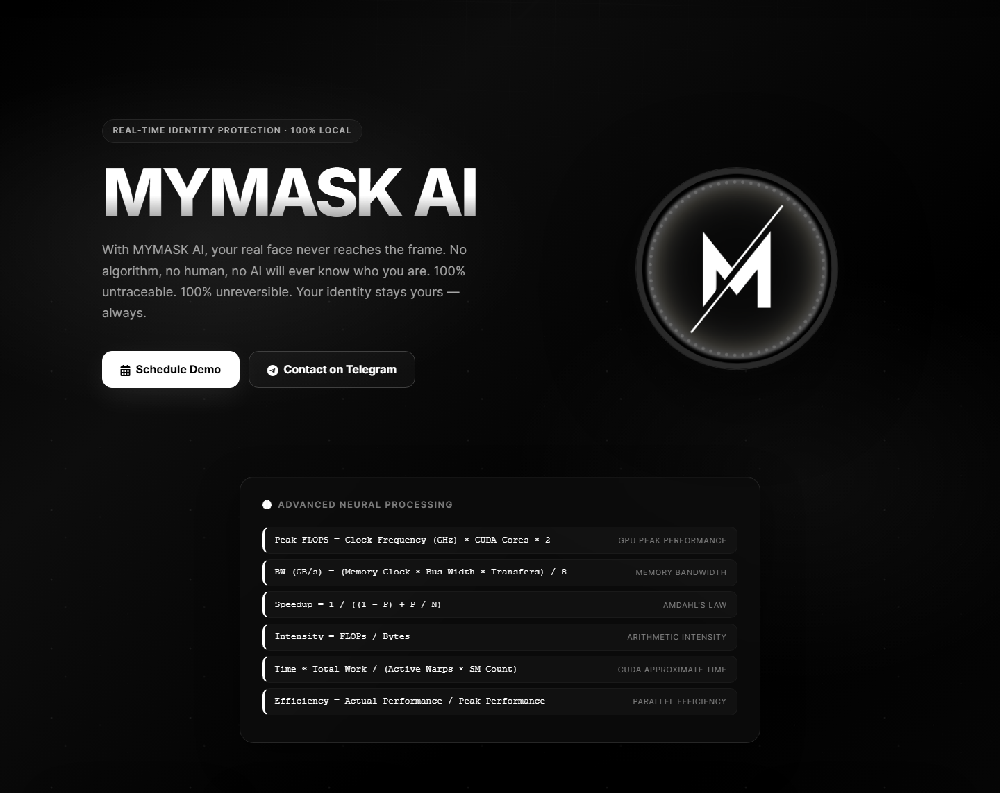 mymask.ai — local real-time identity protection and CUDA processing architecture</td>
<td width="50%" align="center">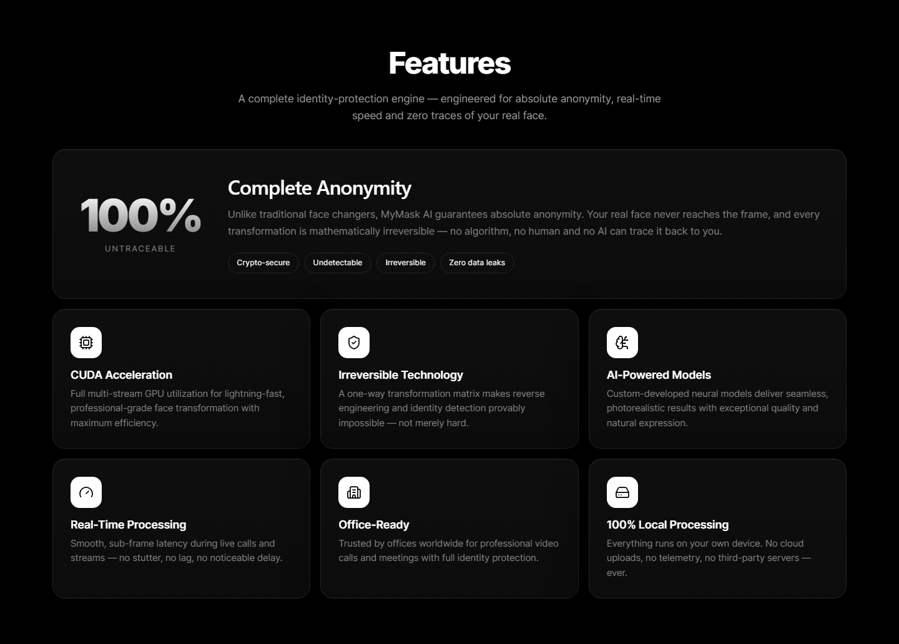 Current feature set — local processing, CUDA acceleration, real-time output and identity models</td>
</tr>
<tr>
<td width="50%" align="center">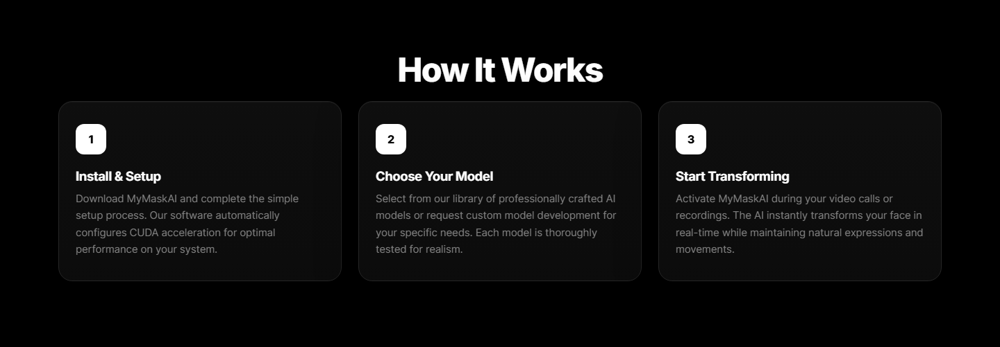 Install, select a permitted model and start transforming in three steps</td>
<td width="50%" align="center">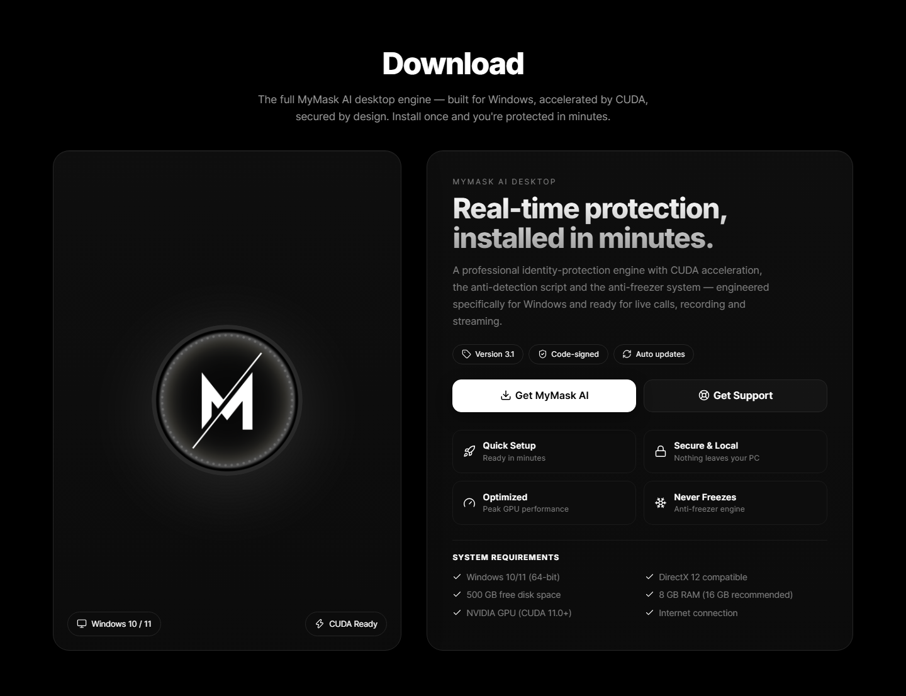 MyMask AI Desktop 3.1 — Windows 10/11, code-signed, CUDA-ready and auto-updating</td>
</tr>
<tr>
<td width="50%" align="center">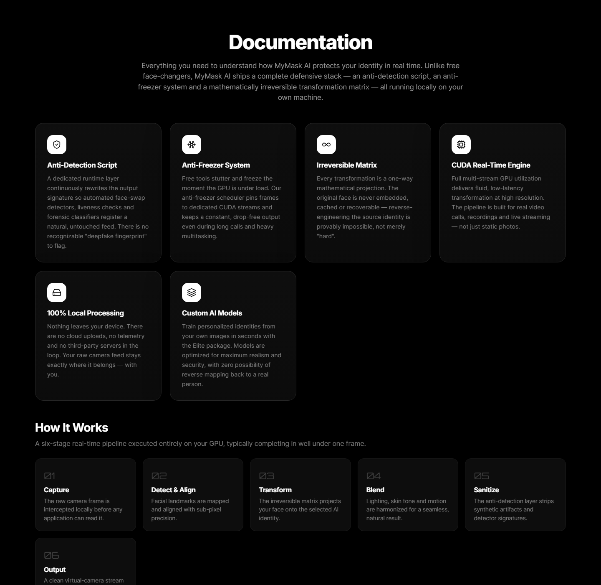 The documented six-stage on-device pipeline and defensive stack</td>
<td width="50%" align="center">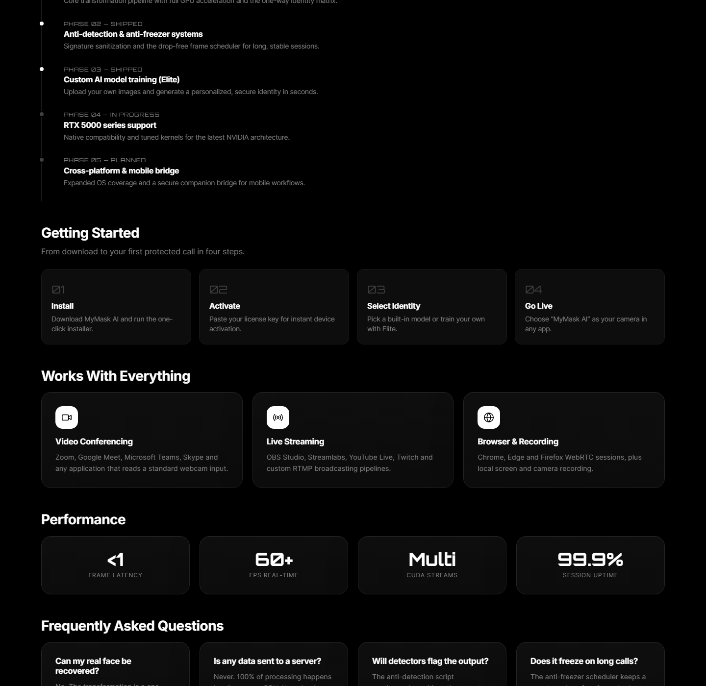 Roadmap, getting started, compatible workflows and performance targets</td>
</tr>
<tr>
<td width="50%" align="center">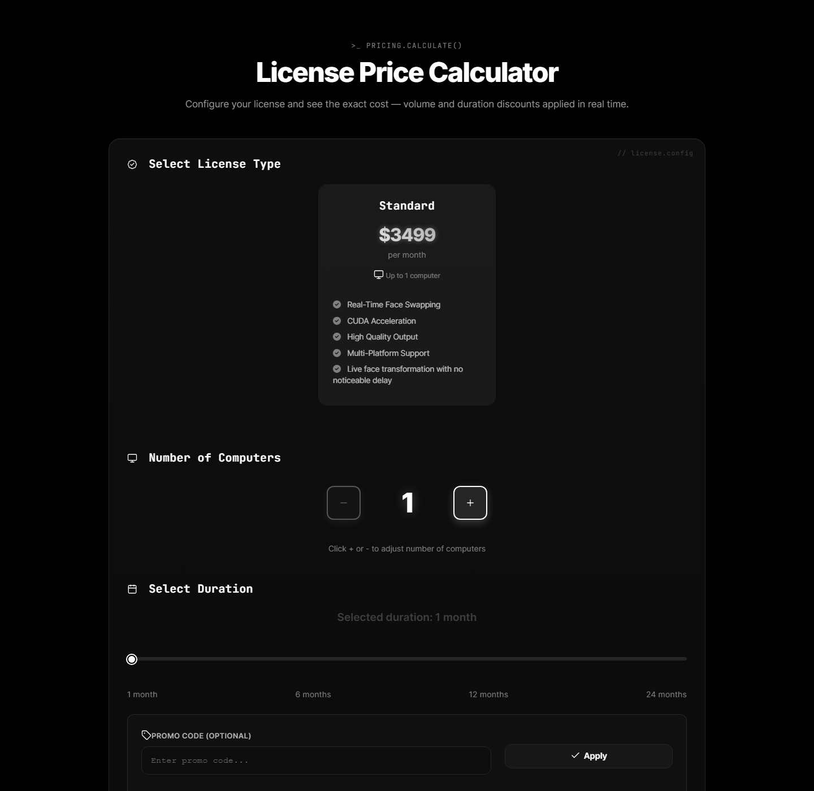 Interactive licence calculator — computers, duration and promo-code support</td>
<td width="50%" align="center">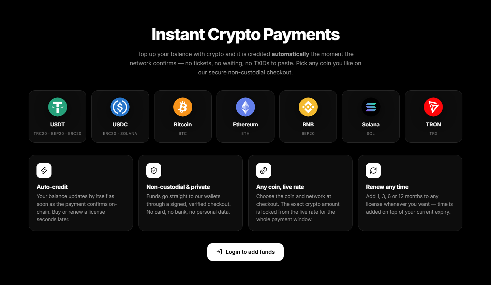 Automatic crypto top-ups across stablecoins and native networks</td>
</tr>
</table>

## ⚙️ How it works

**From camera input to a local virtual-camera output**

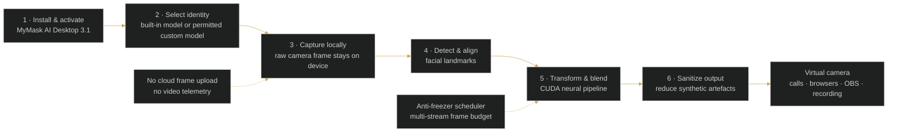

## 🎯 Use cases

<table>
<tr>
<td width="50%" valign="top"><b>🏢 Corporate privacy</b> Protect authorised employee identities in internal and external meetings without changing the conferencing workflow.</td>
<td width="50%" valign="top"><b>🎥 Content creators</b> Publish or stream through a consistent virtual identity while keeping raw camera processing local.</td>
</tr>
<tr>
<td width="50%" valign="top"><b>📰 Journalists & protected sources</b> Use consent-based identity masking for sensitive interviews where exposing a participant would create risk.</td>
<td width="50%" valign="top"><b>🌍 Remote work</b> Select MyMask AI as the camera in daily meetings across supported desktop and browser apps.</td>
</tr>
<tr>
<td width="50%" valign="top"><b>📺 Live streaming</b> Feed a consistent transformed camera into OBS, Streamlabs and RTMP production pipelines.</td>
<td width="50%" valign="top"><b>🛡️ High-security environments</b> Keep the raw camera pipeline on the workstation and evaluate the product against the organisation's own security policy.</td>
</tr>
</table>

## 💳 Pricing

> **Standard licence: $3,499 per month for one computer.** Configure the number of computers and a 1, 6, 12 or 24-month term in the [live licence calculator](https://mymask.ai/#pricing); volume and duration discounts are applied there in real time. Balances can be topped up with supported cryptocurrency and are credited automatically after on-chain confirmation. Renewing adds time on top of the current expiry.

MyMask AI is part of the **Utilities** bundle (−2%) — *Core utility tools* — and of **All In One** (−10%) — *Every product, best price*. Take several products together and save more: [Packages & bundles](https://drogoz.network/#packages) · [Pricing & calculator](https://drogoz.network/pricing/).

| Bundle | Discount | Included |
|---|---|---|
| **Utilities** | −2% | Drog AI, MyMask AI, Replika, IMPERATORI, RiderSwap, Vadira, Skriper |
| **All In One** | −10% | Drog AI, MyMask AI, Replika, Lidaro AI, IMPERATORI, ZOI Talks, RiderSwap, HyperBlast AI, VerifHub AI, Vadira, Skriper |

## 🎥 Free live demonstration

**A live demonstration is 100% free on every product.** 
See MyMask AI in action before you pay — our agent gets in touch and walks you through a live demonstration.

Registration is handled by our team — get in touch and receive personal access.

## 🔗 Links

| Channel | Link |
|---|---|
| 🌐 **Website** | [mymask.ai](https://mymask.ai/) |
| 📄 **Details page** | [drogoz.network/services/MyMask/](https://drogoz.network/services/MyMask/) |
| ✈️ **Telegram group** | [@mymask_pro](https://t.me/mymask_pro) |
| 🏛️ **Drogoz Network** | [drogoz.network](https://drogoz.network) · [Services](https://drogoz.network/#services) · [Packages](https://drogoz.network/#packages) · [Pricing](https://drogoz.network/pricing/) · [Presentation](https://drogoz.network/presentation/) |
| ⚖️ **Legal** | [Terms of Service](https://drogoz.network/legal/terms-of-service/) · [Acceptable Use](https://drogoz.network/legal/acceptable-use-policy/) · [Privacy](https://drogoz.network/legal/privacy-policy/) · [Refunds](https://drogoz.network/legal/refund-policy/) · [Disclaimer](https://drogoz.network/legal/disclaimer/) · [Compliance](https://drogoz.network/legal/compliance-policy/) |
| 🐙 **GitHub** | [deepdrogo](https://github.com/deepdrogo/deepdrogo) |

 

   
  <a href="https://drogoz.network">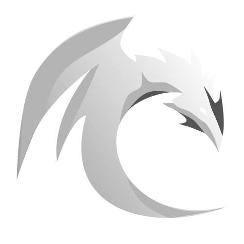</a>
    
  <b>Made by <a href="https://drogoz.network">Drogoz Network</a></b> 
  One network — all your services · Premium SaaS Network
    
  
  
  
  
    
  <b>More from the network:</b> <a href="https://github.com/deepdrogo/drog-ai">Drog AI</a> · <a href="https://github.com/deepdrogo/replika">Replika</a> · <a href="https://github.com/deepdrogo/lidaro-ai">Lidaro AI</a> · <a href="https://github.com/deepdrogo/imperatori">IMPERATORI</a> · <a href="https://github.com/deepdrogo/zoi-talks">ZOI Talks</a> · <a href="https://github.com/deepdrogo/riderswap-io">RiderSwap</a> · <a href="https://github.com/deepdrogo/hyperblast-ai">HyperBlast AI</a> · <a href="https://github.com/deepdrogo/verifhub-ai">VerifHub AI</a> · <a href="https://github.com/deepdrogo/vadira-net">Vadira</a> · <a href="https://github.com/deepdrogo/skriper-io">Skriper</a> · <a href="https://github.com/deepdrogo/drogopay-com">DrogoPay</a> · <a href="https://github.com/deepdrogo/hashgram">Hashgram One</a> · <a href="https://github.com/deepdrogo/mytasker">MyTasker</a> · <a href="https://github.com/deepdrogo/mamont-tech">Mamont</a> · <a href="https://github.com/deepdrogo/drogscan">DrogScan</a>
    
  © 2026 Drogoz Network. All rights reserved. Provided strictly for lawful use — see the <a href="https://drogoz.network/legal/">Legal Center</a>. Each user is solely responsible for how they use the software.

